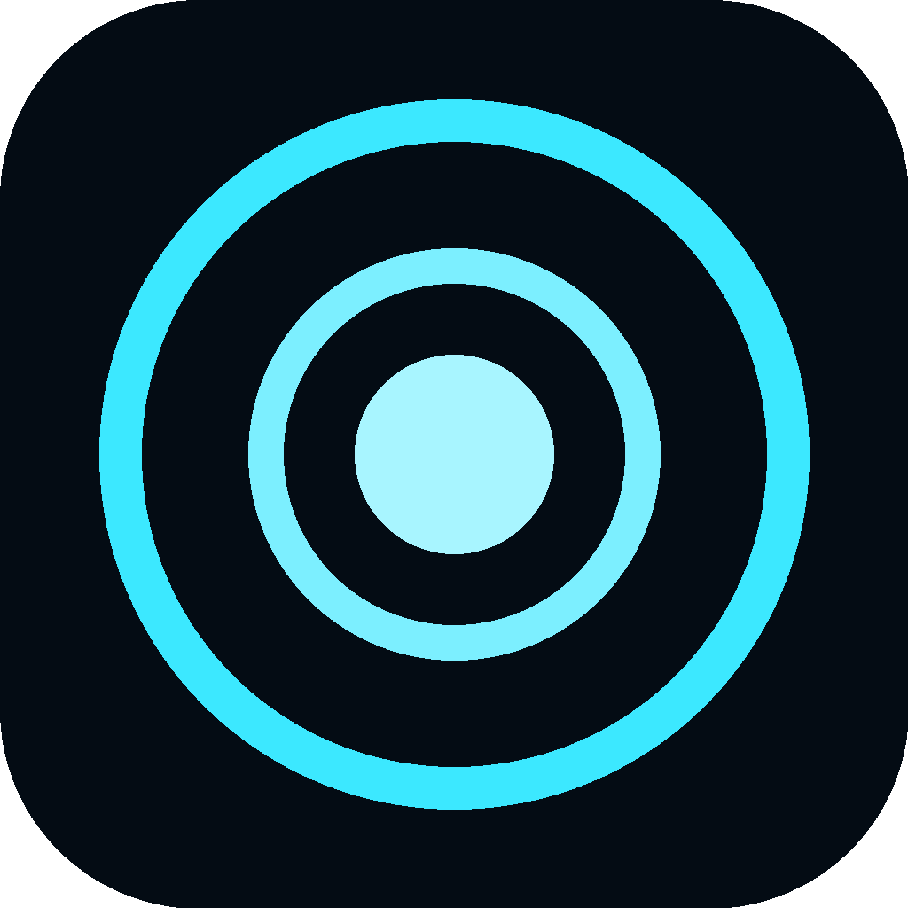

<p align="center">
  
</p>

<h1 align="center">Wesley</h1>

<p align="center">
  <strong>A voice assistant that actually drives your computer.</strong><br>
  Say <em>"Wesley, …"</em>: it opens your apps, clicks, types, reads your screen, codes in VS Code,
  uses your websites (even with 2FA) and manages your servers.<br>
  Powered by <strong>the AI of your choice</strong>: Claude, GPT, Gemini, Mistral, DeepSeek, Grok, OpenRouter…
  or <strong>Ollama / LM Studio (100% local, free)</strong>. macOS and Windows.
</p>

<p align="center">
  <a href="https://github.com/AbdelRMB/Wesley/releases/latest"></a>
  <a href="https://github.com/AbdelRMB/Wesley/releases"></a>
  
  
  <a href="LICENSE"></a>
  <a href="https://github.com/AbdelRMB/Wesley/stargazers"></a>
</p>

<p align="center">
  <a href="https://github.com/AbdelRMB/Wesley/releases/latest"><strong>⬇ Download</strong></a> ·
  <a href="#-what-you-can-say">Examples</a> ·
  <a href="#-features">Features</a> ·
  <a href="#-privacy--security">Privacy</a> ·
  <a href="CONTRIBUTING.md">Contribute</a> ·
  <a href="README.fr.md">🇫🇷 Français</a>
</p>

<p align="center">
  <a href="docs/demo-en.mp4"></a>
  <br><sub>▶ <a href="docs/demo-en.mp4">Watch in HD (MP4)</a> · <a href="docs/demo.mp4">French version</a></sub>
</p>

---

## ✨ Why Wesley?

Most "AI assistants" are a chat window. Wesley is an **agent with hands**: it uses your mouse, keyboard, apps,
files, browser and servers, and tells you out loud what it did.

- 🎙️ **Hands-free.** Wake word ("Wesley") detected **on your machine** (Whisper, running locally). Nothing is sent
  until it hears its name. Interrupt it just by talking.
- 🧠 **Any AI as its brain.** Claude (smartest), OpenAI, Google Gemini, Mistral, DeepSeek, Grok, OpenRouter, Groq,
  Cerebras, Together, Fireworks, Kimi, Qwen, Cohere, Hugging Face, any OpenAI-compatible API, or
  **Ollama / LM Studio: free, offline, nothing leaves your computer.** Several have a free tier.
- 🖥️ **Real computer control.** Apps, files, windows, mouse and keyboard, screen vision, terminal, VS Code, git.
- 🌐 **Learns your websites.** Explores your intranet or business tools read-only, records your demonstrations,
  then does the task for you. Signs in on its own, **including 2FA codes** (TOTP computed locally).
- 🔌 **Connectors + any MCP server.** Gmail/IMAP, calendar, GitHub, Notion, SSH servers (with a setup wizard),
  WhatsApp, Spotify, Slack, Home Assistant… And the other way round: Wesley **is an MCP server itself**, so
  Claude Desktop or Claude Code can search its memory and your transcriptions.
- 📱 **Follows you.** One account: memory, history and to-dos synced across your Mac, PC and phone.
  On your phone Wesley really runs (voice, AI, memory, to-dos, automations): open
  https://wesley.abdelrahimriche.com/mobile/ on your iPhone or Android. "On my PC, launch Discord" works too.
- 🔐 **Safe by design.** Asks before anything destructive, encrypted vault for keys and passwords, full action log,
  emergency stop.
- 📦 **Real app, not a script.** Signed and notarized Mac app, Windows installer, one-click updates.

## 💬 What you can say

> "Wesley, open Discord and put on my focus playlist."
>
> "Look at my screen: why is this build failing?"
>
> "Create an invoice for Dupont on Sage." *(a site it learned)*
>
> "Take a screenshot of the interventions table and send it to Karim on WhatsApp."
>
> "Why is my server slow?" *(over SSH, asks before any sudo command)*
>
> "Create the WESLEY.md for this project." *(its instructions for this project, which it keeps up to date)*
>
> "Remind me to take out the trash at 8 pm." · "Give me my morning briefing."
>
> "From now on, answer in one sentence." *(it remembers your instructions)*

## 🚀 Get started in 2 minutes

1. **Download** the [latest release](https://github.com/AbdelRMB/Wesley/releases/latest):

   | Your computer | File |
   |---|---|
   | Mac with Apple silicon (M1–M4) | `Wesley-<version>-mac-arm64.dmg` |
   | Windows 10/11 PC | `WesleySetup-<version>.exe` |

2. **Install**: drag Wesley into Applications (Mac) or run the installer (Windows, no admin rights needed).
3. **Create your account** (or use it locally without one), then pick a brain in **Settings › Brain**:
   click the AI you want and paste its API key (the screen tells you where to create it): Claude, OpenAI, Gemini,
   Mistral, DeepSeek, Grok, OpenRouter… Or install [Ollama](https://ollama.com) and run `ollama pull qwen3.5:9b`
   (or use [LM Studio](https://lmstudio.ai)) for a free local brain.

Then say **"Wesley, …"** or press `Ctrl+Alt+W` (Windows) / `⌃⌥W` (Mac).

> 🤖 **Even easier:** clone this repo, open it in [Claude Code](https://claude.com/claude-code) and say
> **"Install Wesley"**. The repo ships an install guide (`CLAUDE.md`) and Claude does everything, asking before
> installing anything.

<details>
<summary><strong>Detailed install notes (permissions, SmartScreen, updates)</strong></summary>

**Mac**
1. Open the `.dmg` and drag **Wesley** into **Applications**. The app is signed and notarized by Apple.
2. In **System Settings › Privacy & Security**, allow Wesley for **Microphone**, **Accessibility** (shortcuts,
   mouse, keyboard) and **Screen Recording** (so it can see your screen).

Wesley lives in the **menu bar** and starts when you log in.

**Windows**
1. Run `WesleySetup-<version>.exe`. If Windows shows "Windows protected your PC", click
   **More info › Run anyway**.
2. Tick **"Start Wesley with Windows"** if you want it always ready.

Wesley lives next to the **clock** (notification area).

**First launch**
- If this computer already had a Wesley memory (older version), it is merged into your account, without duplicates.
- Claude is pay-as-you-go: a Claude Pro subscription doesn't include API credit.
- Ollama needs a graphics card with about 8 GB of memory.

**Updating**: the **Updates** screen shows each version with its description and installs it in one click.
Wesley can also update itself automatically at the next start.

</details>

> The interface is available in French and English (Settings › Interface). Wesley speaks French by default.

---

## 🧰 Features

| | |
|---|---|
| **System** | Terminal (PowerShell / zsh), Python scripts, open any app, file or URL, processes, lock / shut down |
| **Files** | Read, write, edit, search (name + content), move, copy, delete (→ trash) |
| **Mouse & keyboard** | Move, click, drag, scroll, type, shortcuts, media / volume, clipboard |
| **Windows** | List, focus, maximize, close, click a button by its text |
| **Vision** | Look at the screen, find an element and click it, analyze an image |
| **Browser** | Its own browser or **yours** (Safari, Chrome, Edge, Brave, Arc on Mac), highlighting each element before acting |
| **Learned sites** | Read-only exploration, demonstrations, tips, auto sign-in with 2FA |
| **Code** | Open in VS Code (file:line), git, scaffold projects (Vite / Next / Node / Python), background coding tasks (Claude Code / Codex), one **WESLEY.md** per project |
| **Web** | Search with sources, news, read a page, weather, download |
| **Memory** | Remembers what it learns about you, your instructions, and lessons from its own mistakes |
| **Organization** | To-do list, reminders spoken at the right time, morning briefing, routines, automations |
| **Connectors** | Gmail, IMAP, iCal, GitHub, Notion, SSH servers (sudo with approval), WhatsApp, **any MCP server**; Wesley is an MCP server too |
| **Voice** | Microsoft neural voices, Piper (local) or **Kyutai** (very natural, local); custom pronunciation dictionary |
| **Devices** | Control your other computers, to-dos and tickets from your phone |

<details>
<summary><strong>Using Wesley: shortcuts</strong></summary>

| Action | How |
|---|---|
| Call it | Say **"Wesley, open Discord"** in one go, or "Wesley" then your request. Or `Ctrl+Alt+W` / `⌃⌥W`, or click the icon. |
| Silence it | **"Wesley, stop"** (even while it's talking), or `Ctrl+Alt+S` / `⌃⌥S`, even with the window hidden. |
| Close the window | It only hides. To quit: Wesley icon › Quit. |
| In the window | `Esc` = stop · `Ctrl+K` = type · `Alt+1…9` = screens |

</details>

<details>
<summary><strong>WESLEY.md: per-project instructions</strong></summary>

Like Claude Code's `CLAUDE.md`, a **`WESLEY.md`** file at the root of a project (and, if needed, in a subfolder)
holds what Wesley needs to know to work on it: overview, useful commands, conventions, decisions, changelog.

- **Read first.** Before coding in, opening or changing a project, Wesley reads its WESLEY.md (root, then the
  relevant subfolder) and follows it before its memory and default rules. Only your request and your personal
  instructions come first.
- **Passed to coding agents.** Background tasks put it at the top of Claude Code's / Codex's instructions.
- **Kept up to date, everywhere.** Whenever Wesley codes in a project, it creates the file if missing and records
  changes, decisions, commands and conventions. A task that forgets is asked once more; otherwise Wesley writes the
  entry itself before the final commit.
- **On request.** "Create the WESLEY.md for this project": Wesley drafts it from the project (README,
  `package.json`, `pyproject.toml`…), then completes it.

</details>

## 🔐 Privacy & security

- **Ollama or LM Studio brain = nothing leaves your computer.** With a cloud AI (Claude, OpenAI, Gemini…), your messages, memories and tool results
  are sent to that provider.
- **Wake word is 100% local.** Audio is only processed after "Wesley".
- **Your password never leaves the device.** It derives a sign-in key and a vault key that encrypts your API key and
  passwords before they're sent. Memory and history are stored on the server, protected but not end-to-end encrypted.
  You can also use Wesley **without an account**.
- **Asks first** before destructive clicks (delete, send, pay…) and every `sudo` command.
- The local interface only listens on `127.0.0.1` (checked Host, per-session token, checked Origin).
- **Emergency stop**: move the mouse to the top-left corner. Every action is logged (`logs/actions.log`).
- **Your data is yours**: Settings › My account › **Download my data** / **Delete my account**.
  [Privacy policy](https://wesley.abdelrahimriche.com/mobile/confidentialite.html) (in French).

## 🏗️ How it works

```
 "Wesley, …" ──► Whisper (local) ──► Agent (Claude / OpenAI / Ollama)
                                                        │  tool calls
                                                        ▼
        apps · files · mouse/keyboard · screen · browser · SSH · MCP servers · connectors
                                                        │
 React interface (pywebview) ◄── FastAPI on 127.0.0.1 ◄─┘──► voice (Microsoft / Piper / Kyutai)
                                                        │
                                   account server (FastAPI + SQLite): memory, history, sync
```

- **Core**: Python 3.12 (`wesley/`), tools in `wesley/outils/`, local server `wesley/web.py` (routes split by area in `wesley/api/`).
- **Interface**: React + TypeScript + Tailwind (`interface/`), shown in a native window (pywebview).
- **Account server**: FastAPI + SQLite (`serveur/`), self-hostable.

---

## 🤝 Contributing

Contributions are very welcome, from typo fixes to new tools. Start with
[`CONTRIBUTING.md`](CONTRIBUTING.md) and the
[good first issues](https://github.com/AbdelRMB/Wesley/labels/good%20first%20issue).
Found a bug or have an idea? [Open an issue](https://github.com/AbdelRMB/Wesley/issues/new/choose)
(English or French).

If Wesley is useful to you, **a ⭐ helps a lot**: it's how other people find the project.

<details>
<summary><strong>Development setup</strong></summary>

Full commands are in [`CLAUDE.md`](CLAUDE.md) (in French), which is also Claude's guide.

**Requirements**: Python **3.12** (not 3.13), Node.js **22+**, git. Optional: Ollama.

```bash
# Mac
python3.12 -m venv .venv-mac && .venv-mac/bin/pip install -r requirements-mac.txt
(cd interface && npm ci && npm run build)
.venv-mac/bin/python lanceur.pyw
```
```powershell
# Windows
py -3.12 -m venv .venv; .venv\Scripts\pip install -r requirements.txt -r requirements-voix.txt
cd interface; npm ci; npm run build; cd ..
.venv\Scripts\pythonw lanceur.pyw          # or wesley-web.bat (browser) / wesley.bat (terminal)
```

**Layout**

| Folder / file | Role |
|---|---|
| `wesley/` | Python core: agent, tools (`outils/`), voice, listening, local server (`web.py` + routes in `api/`), account (`compte.py`), updates |
| `interface/` | React + TypeScript + Tailwind interface, built into `wesley/static/` |
| `serveur/` | Account server (FastAPI + SQLite), built mobile app and legal pages (`mobile/`) |
| `interface/mobile/` | Wesley mobile (phones only): assistant engine and touch screens, reuses `interface/src` |
| `wesley.spec` / `wesley-mac.spec` | PyInstaller recipes (Windows / Mac) |
| `installateur.iss` | Windows installer (Inno Setup) |
| `construire.bat` / `construire-mac.sh` | Build the installers |
| `wesley/version.py` + `CHANGELOG.md` | Version, and the description of each update |

The code, comments and commit messages are in French.

**Live interface**: `cd interface && npm run dev` (http://localhost:5173, wired to the Python server running alongside).

**Adding a tool** in `wesley/outils/*.py`:
```python
@outil
def my_tool(param: str):
    """Description for the model.
    param: description of the parameter"""
    return "result"
```

**Building the installers**: `bash construire-mac.sh` (Mac) or `construire.bat` (Windows, Inno Setup 6), or on
GitHub: **Actions › Versions de Wesley › Run workflow**.

**Self-hosting the account server**: run `serveur/app.py` with uvicorn behind an HTTPS proxy (`WESLEY_DB` and
`WESLEY_CLE_APPLI` variables), then set `"serveur_comptes"` and `"cle_appli"` in the app's `config.json`.

**Where is my data?**

| | Mac | Windows |
|---|---|---|
| Device settings, logs, account cache | `~/Library/Application Support/Wesley` | `%LOCALAPPDATA%\Wesley` |
| Memory, history, connectors, shared settings | in your **account** (cached locally) | same |
| API key, connector passwords | macOS Keychain + encrypted account vault | Credential Manager + encrypted account vault |

Diagnostics: `logs/wesley.log` (startup, errors), `logs/perf.log` (model speed), `logs/couts.json`
(estimated Claude API spending).

</details>

## ⭐ Star history

<a href="https://star-history.com/#AbdelRMB/Wesley&Date">
  
</a>

## 📄 License

Copyright (C) 2026 Abdelrahim Riche. Wesley is free software under the
**GNU General Public License v3** (or any later version): you can use, study, modify and share it; modified
versions you distribute must stay under the same license, with their source code. It comes with **absolutely no
warranty**. Full text: [LICENSE](LICENSE).
